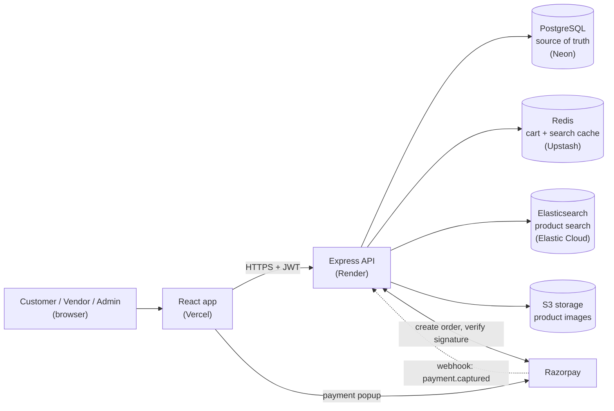
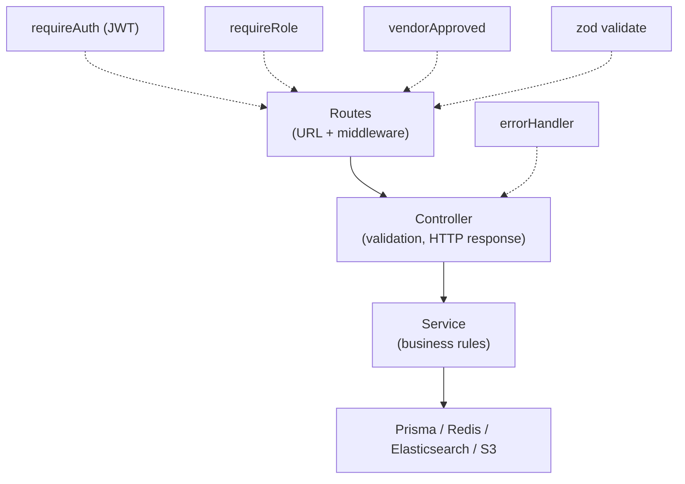
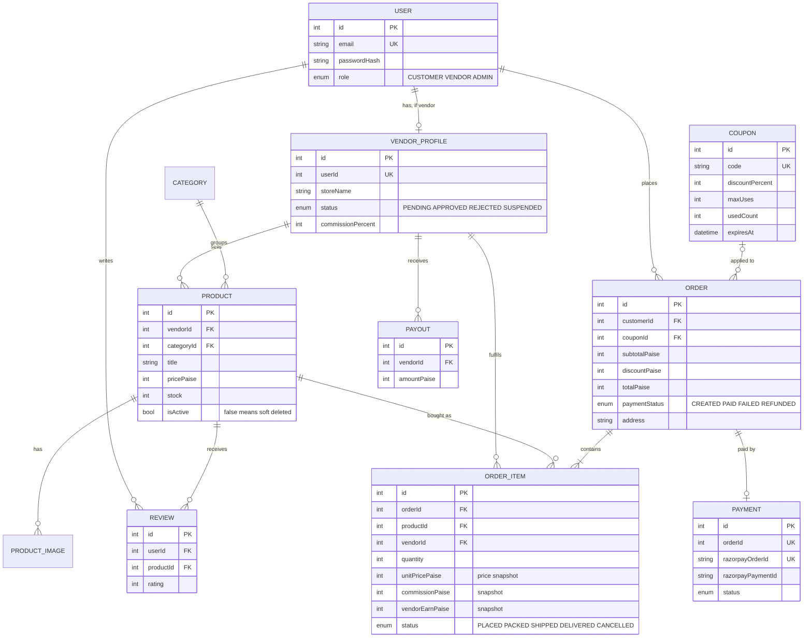
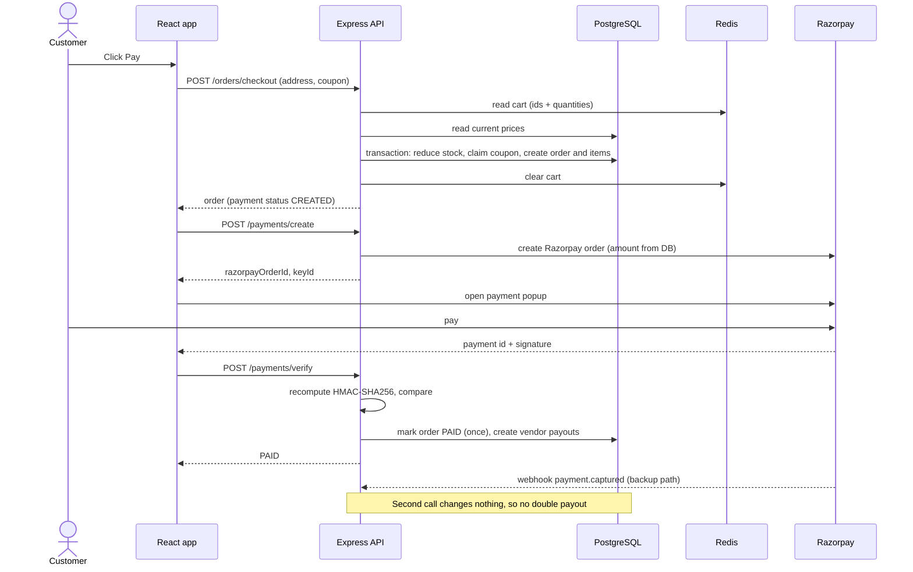
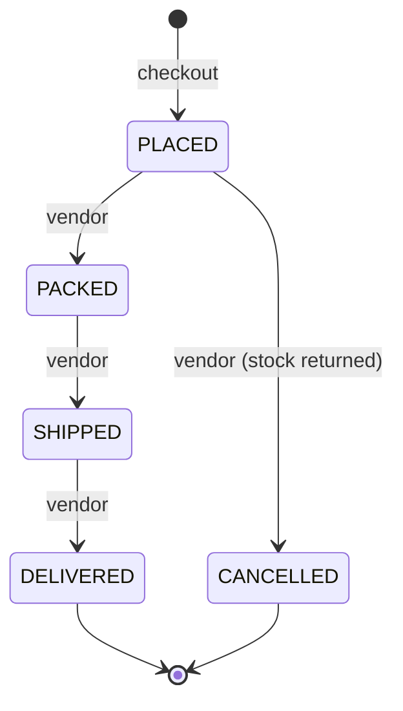
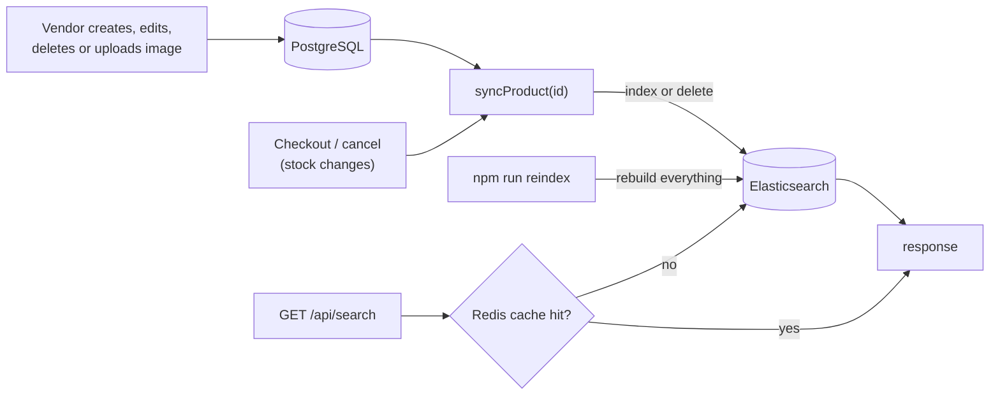

# Architecture

The diagrams below use Mermaid, which GitHub renders automatically. For slides, open this file on GitHub (or paste a block into https://mermaid.live) and export a PNG.

## 1. System architecture

**How the pieces work together**

- PostgreSQL holds all real data. Everything else can be rebuilt or is temporary.
- Elasticsearch holds a searchable copy of each product, updated after every product change.
- Redis holds each customer's cart (key `cart:<userId>`, 7 day expiry) and cached search results (30 seconds).
- Images go to S3 storage. Only the URL is saved in PostgreSQL.
- Razorpay handles card details, so they never touch our server.

## 2. Backend layers

## 3. Database schema

All prices are integers in paise (100 paise = 1 rupee).

`REVIEW` has a unique key on (userId, productId), so one review per customer per product.

## 4. Checkout and payment flow

If the customer closes the popup, the order stays unpaid. They can use **Pay now** or **Cancel order** later. Cancelling puts the stock back and returns the coupon use.

## 5. Order item status flow

Vendors only see an order after payment is PAID. Skipping a step (for example PLACED to DELIVERED) is rejected with 400. A customer can review a product only after the item is DELIVERED.

## 6. Search sync

If the sync fails it is only logged, so a search problem never blocks the vendor. The reindex script repairs any difference.

## 7. Security measures

| Measure | Where |
|---|---|
| Passwords hashed with bcrypt | auth service |
| JWT with role, checked on every protected route | `requireAuth`, `requireRole` |
| Admin cannot be created through public registration | register schema |
| Vendor can only change own products | `vendorId` filter in product service |
| Request bodies validated | zod schemas |
| Payment amount calculated on the server | payment service |
| Payment signature verified with constant-time compare | payment service |
| Image type and size limits, random file names | upload middleware |
| Security headers | helmet |
| Secrets only in `.env`, never committed | `.gitignore` |